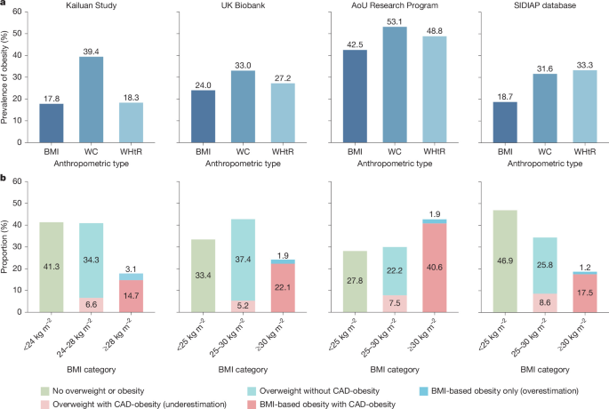
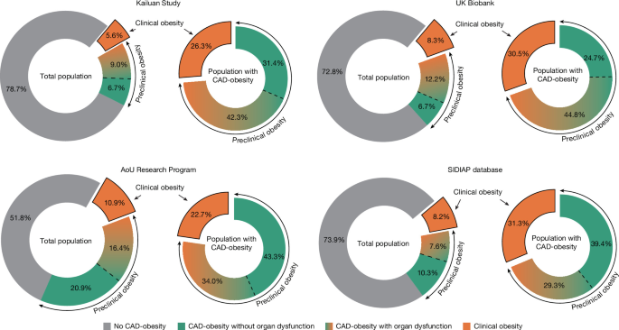
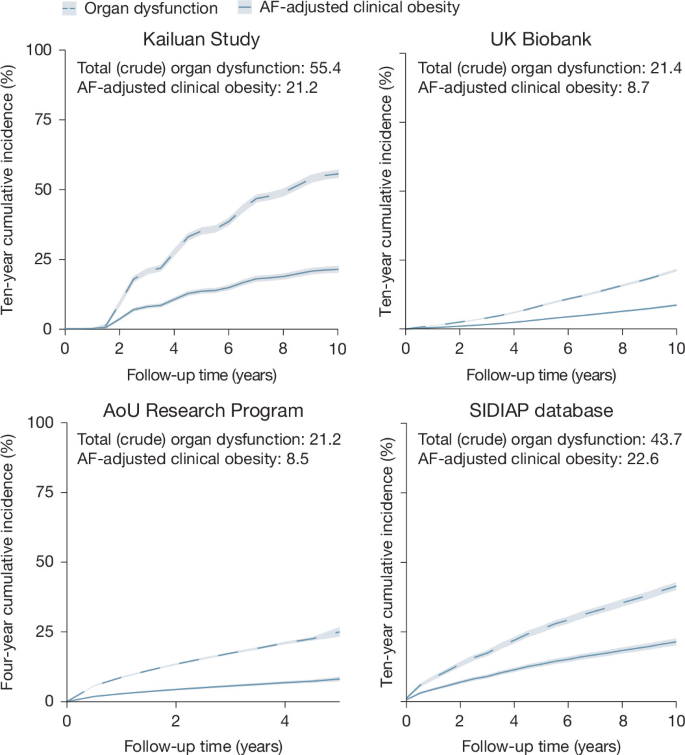
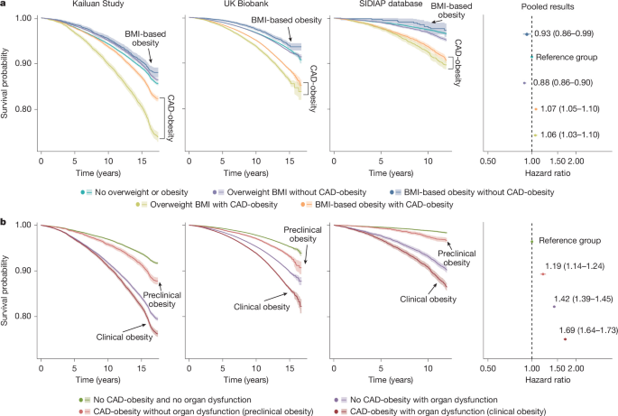

# Validation of clinical and preclinical obesity across global cohorts

**中文标题**：全球多队列中对临床肥胖与临床前肥胖的验证

| 项目 | 内容 |
| --- | --- |
| 期刊 | *Nature*（Article） |
| 在线日期 | 2026-11-11 |
| DOI | [10.1038/s41586-026-11237-5](https://doi.org/10.1038/s41586-026-11237-5) |
| 原文链接 | [nature.com](https://www.nature.com/articles/s41586-026-11237-5) |
| 作者 | Pan, An, Yang, Shengping, Ramos, Rafael, Li, Xianli, Xie, Jinchi, Eckel, Robert H., Mingrone, Geltrude, Blanch, Jordi, Jiang, Jingyuan, Liu, Hongmin, Chen, Shuohua, Geng, Tingting, Wu, Shouling, Ravussin, Eric, Fernández-Real, José Manuel, Rubino, Francesco |
| 图片 | 4 张（见下，图注中英对照） |

---

## 摘要 / Abstract

**EN**

> In 2025, a Lancet Commission proposed distinguishing clinical obesity, defined by adiposity-related organ dysfunction, from preclinical obesity, defined by excess adiposity with preserved function, and recommended using anthropometric measures beyond body mass index (BMI) to confirm obesity status 1. Here we report the comparative performance of this framework versus conventional BMI-based classification using prevalence, incidence and mortality data from 844,108 adults across four cohorts in China, the UK, the USA and Spain. Complementing BMI with waist circumference and waist-to-height ratio data showed that BMI alone overestimated obesity in 1.2–3.1% and underestimated it in 5.2–8.6% of participants across cohorts. The combined anthropometric definition increased overall obesity prevalence by 3.3–7.4% relative to BMI-based classification. Clinical obesity accounted for 22.7–31.3% of total obesity, with an overall population prevalence of 5.6–10.9%. A large proportion of individuals (between 77.4% and 91.3%) with preclinical obesity at baseline showed no progression to clinical obesity over 10 years. Increased mortality risk was associated with the combined anthropometric definition of obesity, but not with BMI-only obesity. Clinical obesity was associated with substantially higher all-cause mortality (hazard ratio 1.69, 95% confidence interval 1.64–1.73), whereas preclinical obesity conferred only modest risk (1.19, 1.14–1.24). These findings support the global adoption of the Lancet Commission diagnostic framework to improve obesity care and policy.

**中文**

> 2025 年，柳叶刀委员会（Lancet Commission）提出将临床肥胖（由肥胖相关器官功能障碍定义）与临床前肥胖（脂肪过多但功能保留）区分开来，并建议使用 BMI 以外的人体测量指标确认肥胖状态。本文基于中国、英国、美国和西班牙四个队列共 844,108 名成年人的患病率、发病率与死亡率数据，报告该框架相对于传统基于 BMI 分类的比较表现。在 BMI 之外补充腰围（WC）与腰高比（WHtR）数据后发现：仅用 BMI 会在各队列中高估 1.2–3.1%、低估 5.2–8.6% 参与者的肥胖状态；联合人体测量定义使总肥胖患病率相对 BMI 分类提高 3.3–7.4%。临床肥胖占总肥胖的 22.7–31.3%，人群总患病率为 5.6–10.9%。基线时为临床前肥胖者中很大比例（77.4%–91.3%）在 10 年内未进展为临床肥胖。联合人体测量定义的肥胖与死亡风险升高相关，而仅基于 BMI 的肥胖则不然。临床肥胖与全因死亡率显著升高相关（风险比 1.69，95% 置信区间 1.64–1.73），而临床前肥胖仅带来轻度风险（1.19，1.14–1.24）。这些发现支持在全球采用柳叶刀委员会的诊断框架，以改善肥胖诊疗与政策。

---

## 图片对照 / Figures

### Fig. 1: Prevalence and classification accuracy for BMI-based obesity versus CAD-obesity.

**EN**

> Definitions of BMI-based obesity, WC-based obesity, WHtR-based obesity and CAD-obesity are provided in the Methods. The analyses included 137,795 participants from the Kailuan Study, 436,203 participants from the UK Biobank, 218,841 participants from the All of Us (AoU) Research Program and 51,269 participants from the SIDIAP database. Prevalence estimates are presented as percentages. a, Prevalence of obesity defined separately by BMI, WC and WHtR. b, Reclassification of obesity status across BMI-defined categories after applying CAD-obesity criteria. Colours indicate the corresponding reclassification categories as defined in the figure.

**中文**

> 基于 BMI、WC、WHtR 的肥胖及 CAD 肥胖的定义见方法。分析纳入开滦研究 137,795 人、英国生物样本库 436,203 人、All of Us 研究计划 218,841 人和 SIDIAP 数据库 51,269 人。患病率以百分比表示。a，分别按 BMI、WC 与 WHtR 定义的肥胖患病率。b，应用 CAD 肥胖标准后，BMI 定义各分类中肥胖状态的重新归类；颜色表示图中定义的相应重分类类别。

*原图：s41586-026-11237-5 Fig. 1 · [Nature 全尺寸](https://www.nature.com/articles/s41586-026-11237-5/figures/1)*

### Fig. 2: Prevalence of preclinical obesity and clinical obesity in all participants and in participants with CAD-obesity.

**EN**

> Definitions of CAD-obesity, preclinical obesity and clinical obesity are provided in the Methods. The analyses included 137,795 participants from the Kailuan Study, 436,203 participants from the UK Biobank, 218,841 participants from the All of Us Research Program and 51,269 participants from the SIDIAP database. Grey segments represent individuals without CAD-obesity. Orange segments represent the estimated AF-adjusted prevalence component of clinical obesity, corresponding to CAD-obesity with organ dysfunction statistically attributable to CAD-obesity at the population level. Green segments represent individuals with CAD-obesity but without evidence of organ dysfunction. Segments with a colour gradient represent the estimated non-attributable prevalence component among participants with CAD-obesity and organ dysfunction after application of the AF adjustment. Together, the green and gradient segments represent the estimated AF-adjusted prevalence of preclinical obesity.

**中文**

> CAD 肥胖、临床前肥胖与临床肥胖的定义见方法。分析纳入开滦研究 137,795 人、英国生物样本库 436,203 人、All of Us 研究计划 218,841 人和 SIDIAP 数据库 51,269 人。灰色段为无 CAD 肥胖者；橙色段为临床肥胖中经 AF（归因分数）校正的患病率成分，对应人群水平上器官功能障碍可统计学归因于 CAD 肥胖者；绿色段为有 CAD 肥胖但无器官功能障碍证据者；带颜色渐变的段为应用 AF 校正后，CAD 肥胖且伴器官功能障碍者中估计的非归因患病率成分。绿色段与渐变段合计代表经 AF 校正的临床前肥胖估计患病率。

*原图：s41586-026-11237-5 Fig. 2 · [Nature 全尺寸](https://www.nature.com/articles/s41586-026-11237-5/figures/2)*

### Fig. 3: Cumulative incidence of organ dysfunction and AF-adjusted clinical obesity among individuals with preclinical obesity at baseline.

**EN**

> The analyses included 8,009 participants from the Kailuan Study, 29,338 participants from the UK Biobank, 54,535 participants from the All of Us Research Program and 5,273 participants from the SIDIAP database, all of whom had preclinical obesity at baseline. Solid lines represent the estimated cumulative incidence of clinical obesity, calculated by applying AF-based estimates to the observed incidence of organ dysfunction among individuals with preclinical obesity. Dashed lines represent the observed cumulative incidence of incident organ dysfunction. Shaded areas represent the corresponding 95% CIs. Cumulative incidence curves were estimated using Kaplan–Meier methods and were generated from baseline until incident organ dysfunction, death or the end of follow-up, whichever occurred first. AF estimates were calculated from HRs derived using Cox proportional hazards models adjusted for cohort-specific covariates, as described in the Supplementary Methods.

**中文**

> 分析纳入基线为临床前肥胖的开滦研究 8,009 人、英国生物样本库 29,338 人、All of Us 研究计划 54,535 人和 SIDIAP 数据库 5,273 人。实线为临床肥胖的估计累积发病率，由 AF 估计值应用于临床前肥胖者中观测到的器官功能障碍发病率计算得到；虚线为观测到的新发器官功能障碍累积发病率；阴影为相应 95% CI。累积发病率曲线以 Kaplan–Meier 法估计，自基线起至新发器官功能障碍、死亡或随访结束（以先发生者为准）。AF 估计值由 Cox 比例风险模型得到的 HR 计算，模型按各队列特定协变量校正，详见补充方法。

*原图：s41586-026-11237-5 Fig. 3 · [Nature 全尺寸](https://www.nature.com/articles/s41586-026-11237-5/figures/3)*

### Fig. 4: Cumulative survival and hazard ratios of mortality by BMI-based obesity, CAD-obesity and clinical obesity status.

**EN**

> The analyses included 137,792 participants from the Kailuan Study, 436,203 participants from the UK Biobank and 51,269 participants from the SIDIAP database. Each panel presents Kaplan–Meier survival curves and adjusted HRs with 95% CIs for all-cause mortality, with cohort-specific survival curves shown on the left and pooled HR estimates from Cox proportional hazards models shown on the right. Solid lines in Kaplan–Meier plots represent survival probability estimates for each obesity classification group, with colours indicating the categories defined in each panel. Shaded areas around survival curves indicate 95% CIs. In forest plots, points represent HR point estimates and horizontal lines represent corresponding 95% CIs. The x axes of the forest plots are presented on a logarithmic scale. Cox proportional hazards models were adjusted for cohort-specific covariates as specified in the Supplementary Methods, and pooled HR estimates were obtained using fixed-effects models. All statistical tests were two-sided, and no adjustment for multiple comparisons was performed. a, Mortality risk according to BMI-based overweight or obesity and CAD-obesity status. Colours indicate BMI-based categories combined with CAD-obesity status: no overweight or obesity; overweight BMI without CAD-obesity; BMI-based obesity without CAD-obesity; overweight BMI with CAD-obesity; and BMI-based obesity with CAD-obesity. b, Mortality risk according to obesity stage defined by CAD-obesity and organ dysfunction, including preclinical and clinical obesity. Colours indicate four groups: no CAD-obesity and no organ dysfunction; no CAD-obesity with organ dysfunction; CAD-obesity without organ dysfunction (preclinical obesity); and CAD-obesity with organ dysfunction (clinical obesity).

**中文**

> 分析纳入开滦研究 137,792 人、英国生物样本库 436,203 人和 SIDIAP 数据库 51,269 人。各面板给出全因死亡的 Kaplan–Meier 生存曲线及校正后 HR（95% CI）：左侧为各队列生存曲线，右侧为 Cox 比例风险模型的合并 HR 估计。Kaplan–Meier 图中实线为各肥胖分类组的生存概率估计，颜色表示各面板中定义的类别；生存曲线周围阴影为 95% CI。森林图中点为 HR 点估计，水平线为相应 95% CI，横轴为对数刻度。Cox 模型按补充方法所述各队列协变量校正，合并 HR 由固定效应模型获得。所有统计检验为双侧，未做多重比较校正。a，按基于 BMI 的超重/肥胖与 CAD 肥胖状态的死亡风险；颜色表示 BMI 类别与 CAD 肥胖状态的组合：无超重或肥胖；超重但无 CAD 肥胖；基于 BMI 的肥胖但无 CAD 肥胖；超重伴 CAD 肥胖；基于 BMI 的肥胖伴 CAD 肥胖。b，按由 CAD 肥胖与器官功能障碍定义的肥胖分期（含临床前与临床肥胖）的死亡风险；颜色表示四组：无 CAD 肥胖且无器官功能障碍；无 CAD 肥胖但伴器官功能障碍；有 CAD 肥胖但无器官功能障碍（临床前肥胖）；有 CAD 肥胖且伴器官功能障碍（临床肥胖）。

*原图：s41586-026-11237-5 Fig. 4 · [Nature 全尺寸](https://www.nature.com/articles/s41586-026-11237-5/figures/4)*

---

抓取时间：2026-11-15T14:13:24.084Z · 文本与图注版权归 Springer Nature 所有，此处仅作个人阅读与研究存档。
