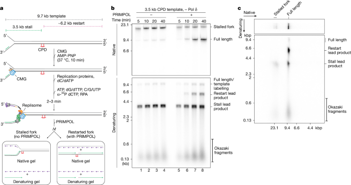
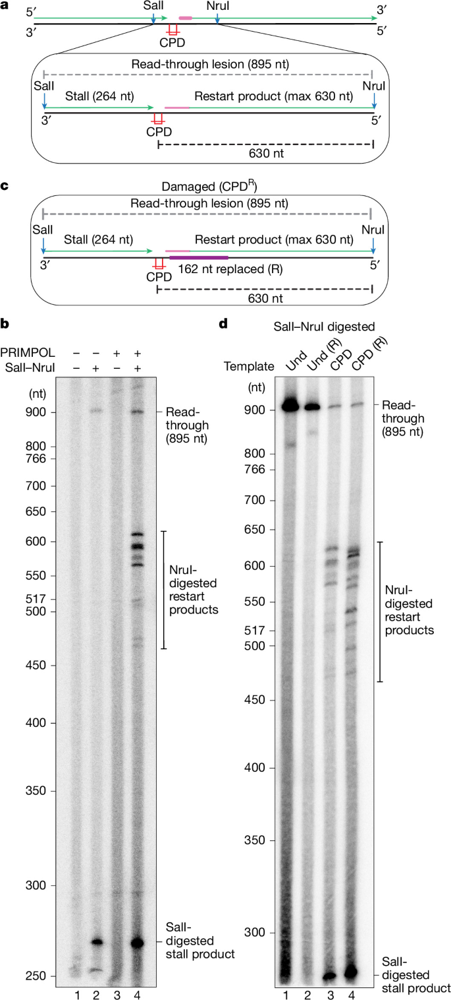
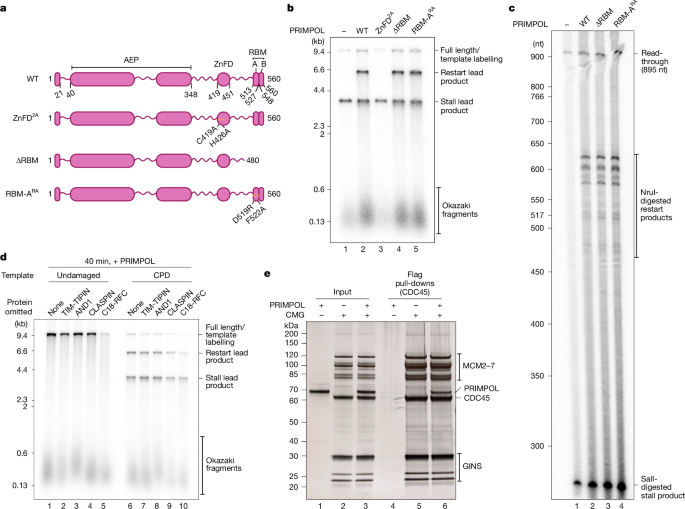
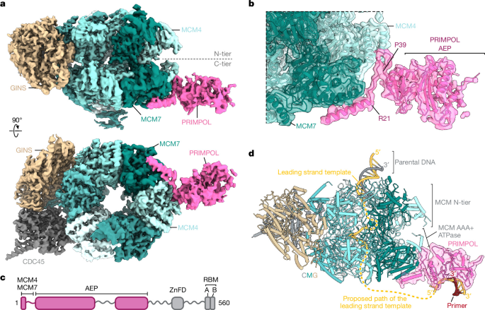
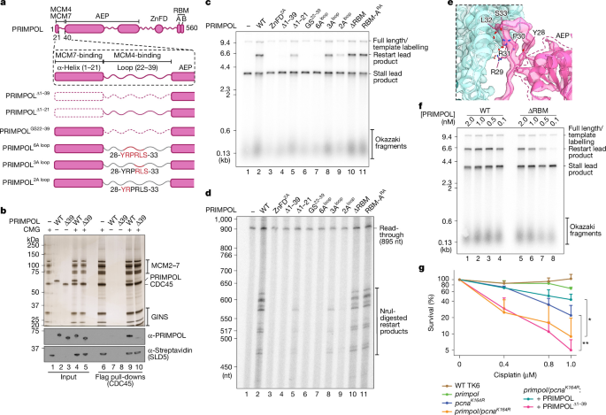
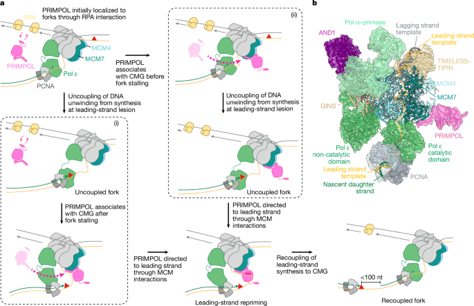

# Human replisomes direct a dedicated leading-strand primase for fork restart

**中文标题**：人类复制体引导专司前导链的引发酶实现复制叉重启

| 项目 | 内容 |
| --- | --- |
| 期刊 | *Nature*（Article） |
| 在线日期 | 2026-11-11 |
| DOI | [10.1038/s41586-026-11204-0](https://doi.org/10.1038/s41586-026-11204-0) |
| 原文链接 | [nature.com](https://www.nature.com/articles/s41586-026-11204-0) |
| 作者 | Polo Rivera, Cristian, Roske, Johann J., Hands, Emma L., Fassetta, Federico, Sale, Julian E., Yeeles, Joseph T. P. |
| 图片 | 6 张（见下，图注中英对照） |

---

## 摘要 / Abstract

**EN**

> Disruptions to leading-strand synthesis impair and stall replication forks because DNA synthesis by the leading-strand polymerase, Pol ε, is essential for optimal template unwinding by the replicative CMG (CDC45–MCM–GINS) helicase 1, 2. Failure to efficiently restart and/or protect stalled replication forks is a major source of genomic instability 3, 4, 5, 6. Stalled forks can be restarted by a variety of mechanisms, including repriming downstream of the impediment 4. In human cells, the primase–polymerase PRIMPOL promotes fork progression during replication stress 7, 8, 9, 10, but how its activity is coordinated by the replisome is unresolved. Here, by reconstituting replication fork stalling and restart with purified human proteins, we show that the CMG helicase directs PRIMPOL for efficient replication fork restart. Unexpectedly, the interaction between PRIMPOL and replication protein A 9, 11 is not critical for fork restart in this system. We show that PRIMPOL binds directly to CMG, and a cryo-electron microscopy structure illustrates how this targets PRIMPOL specifically for leading-strand priming to minimize the size of post-replicative gaps. Ablating the CMG–PRIMPOL interaction abolishes fork restart in vitro and PRIMPOL-dependent DNA damage tolerance in human cells. Our work establishes PRIMPOL as an integrated component of the human replisome dedicated to leading-strand priming.

**中文**

> 前导链合成的中断会损伤并阻滞复制叉，因为前导链聚合酶 Pol ε 的 DNA 合成对于复制性 CMG（CDC45–MCM–GINS）解旋酶实现最佳模板解旋是必需的。未能有效重启和/或保护停滞的复制叉，是基因组不稳定的主要来源。停滞的复制叉可通过多种机制重启，包括在障碍下游重新引发（repriming）。在人类细胞中，引发酶–聚合酶 PRIMPOL 在复制压力下促进复制叉推进，但其活性如何被复制体协调尚不清楚。本文通过用纯化的人源蛋白重构复制叉停滞与重启，证明 CMG 解旋酶引导 PRIMPOL 高效重启复制叉。出乎意料的是，在该体系中 PRIMPOL 与复制蛋白 A（RPA）的相互作用对复制叉重启并不关键。我们发现 PRIMPOL 直接结合 CMG，冷冻电镜结构展示了它如何被特异性地导向进行前导链引发，从而把复制后缺口的尺寸降到最小。消除 CMG–PRIMPOL 相互作用会在体外完全阻断复制叉重启，并消除人细胞中依赖 PRIMPOL 的 DNA 损伤耐受。本工作确立了 PRIMPOL 是人类复制体中一个整合的组分，专司前导链引发。

---

## 图片对照 / Figures

### Fig. 1: Reconstitution of PRIMPOL-dependent leading-strand restart.

**EN**

> a, Schematic of the forked-DNA replication assay with a template containing a leading-strand CPD lesion. b, Time course of a replication assay on the leading-strand CPD template in the absence or presence of PRIMPOL. c, Two-dimensional gel analysis of a 30-min replication reaction in the presence of PRIMPOL.

**中文**

> a，含前导链 CPD 损伤模板的叉状 DNA 复制实验示意图。b，在不加或加入 PRIMPOL 的情况下，前导链 CPD 模板上复制实验的时程。c，加入 PRIMPOL 时 30 分钟复制反应的二维凝胶分析。

*原图：s41586-026-11204-0 Fig. 1 · [Nature 全尺寸](https://www.nature.com/articles/s41586-026-11204-0/figures/1)*

### Fig. 2: The DNA template sequence influences restart products.

**EN**

> a, Schematic of the predicted products generated from digestion of replication products with SalI and NruI. b, Urea polyacrylamide gel of a 40-min replication reaction processed as in a. c, Schematic of the DNA template in which a 162-nt sequence after the CPD was replaced with an alternative sequence. d, Urea polyacrylamide gel of a 40-min replication reaction containing PRIMPOL, processed as in a. Pol δ was omitted from the experiments in b and d. Und, undamaged.

**中文**

> a，用 SalI 与 NruI 酶切复制产物后所生成预测产物的示意图。b，按 a 处理后的 40 分钟复制反应的尿素聚丙烯酰胺凝胶。c，将 CPD 之后一段 162 nt 序列替换为另一序列的 DNA 模板示意图。d，含 PRIMPOL 的 40 分钟复制反应（按 a 处理）的尿素聚丙烯酰胺凝胶。b 和 d 的实验中去除了 Pol δ。Und，未损伤。

*原图：s41586-026-11204-0 Fig. 2 · [Nature 全尺寸](https://www.nature.com/articles/s41586-026-11204-0/figures/2)*

### Fig. 3: PRIMPOL recruitment for restart is independent of its RPA interaction.

**EN**

> a, Primary structure diagrams showing full-length PRIMPOL and PRIMPOL point mutants and truncations. b, Denaturing agarose gel analysis of a 40-min replication reaction with the indicated PRIMPOL mutants. c, Urea polyacrylamide gel analysis of a 40-min replication reaction on the CPD template performed with the indicated PRIMPOL RPA binding mutants. Products were digested post-replicatively with SalI and NruI. d, Denaturing agarose gel analysis of a 40-min replication reaction with dropouts of non-essential replisome components on undamaged and CPD templates in the presence of PRIMPOL. e, Silver-stained SDS–PAGE analysis of a pull-down experiment with the indicated proteins. WT, wild type.

**中文**

> a，全长 PRIMPOL 以及 PRIMPOL 点突变体与截短体的初级结构示意图。b，使用所示 PRIMPOL 突变体的 40 分钟复制反应的变性琼脂糖凝胶分析。c，使用所示 PRIMPOL RPA 结合突变体在 CPD 模板上进行 40 分钟复制反应的尿素聚丙烯酰胺凝胶分析，产物在复制后经 SalI 与 NruI 酶切。d，在加入 PRIMPOL 的条件下，缺失非必需复制体组分后于未损伤模板和 CPD 模板上进行 40 分钟复制反应的变性琼脂糖凝胶分析。e，使用所示蛋白进行 pull-down 实验的银染 SDS–PAGE 分析。WT，野生型。

*原图：s41586-026-11204-0 Fig. 3 · [Nature 全尺寸](https://www.nature.com/articles/s41586-026-11204-0/figures/3)*

### Fig. 4: Cryo-EM structure of PRIMPOL bound to the CMG helicase.

**EN**

> a, Cryo-EM density map of the CMG–PRIMPOL structure coloured by subunit occupancy. b, Close-up view of PRIMPOL bound to MCM4 and MCM7. The atomic model is shown in ribbon representation; the cryo-EM density is shown as a semi-transparent surface. c, Primary structure diagram of PRIMPOL with the regions visible in the cryo-EM structure shown in pink. d, Model illustrating the possible path of DNA from CMG to PRIMPOL. The protein structure shown is the CMG–PRIMPOL structure from this study. The DNA in the model was generated by superpositioning the PRIMPOL–DNA structure (Protein Data Bank (PDB): 5L2X ) and CMG-forked DNA structure (PDB: 7PFO ) onto the PRIMPOL–CMG structure in this study.

**中文**

> a，按亚基占据情况着色的 CMG–PRIMPOL 结构冷冻电镜密度图。b，PRIMPOL 与 MCM4、MCM7 结合处的近景；原子模型以飘带模型显示，冷冻电镜密度以半透明表面显示。c，PRIMPOL 的初级结构示意图，粉色为冷冻电镜结构中可见的区域。d，展示 DNA 从 CMG 通向 PRIMPOL 的可能路径的模型；所用蛋白结构为本研究的 CMG–PRIMPOL 结构，模型中的 DNA 由将 PRIMPOL–DNA 结构（PDB：5L2X）与 CMG 叉状 DNA 结构（PDB：7PFO）叠合到本研究的 PRIMPOL–CMG 结构上生成。

*原图：s41586-026-11204-0 Fig. 4 · [Nature 全尺寸](https://www.nature.com/articles/s41586-026-11204-0/figures/4)*

### Fig. 5: The CMG–PRIMPOL interaction is essential for replication fork restart.

**EN**

> a, Primary structure diagrams of PRIMPOL focusing on the regions in the N terminus that bind to MCM7 and MCM4. Mutants generated within that region are shown. b, Silver-stained and western blot SDS–PAGE analysis of a pull-down experiment with the indicated proteins. c, d, Denaturing agarose ( c ) and urea polyacrylamide ( d ) gel analysis of 40-min replication reactions with PRIMPOL mutants. Samples in d were digested post-replicatively with SalI and NruI. e, Close-up view of the interaction between PRIMPOL and MCM4. The model is shown in ribbon representation in semi-transparent cryo-EM density. Amino acid residues targeted for mutagenesis are depicted (sticks). f, Denaturing agarose gel analysis of a 40-min replication reaction on the CPD template with the indicated PRIMPOL concentrations. g, Cisplatin sensitivity assay performed for the TK6 cell lines specified. The data are the average of three biological replicates, and error bars represent the standard deviation. P values are the result of statistical testing using two-way analysis of cell survival data by fitting a linear quadratic model with maximum likelihood (see Extended Data Table 2 for all P values); pcna K164R compared with +PRIMPOL ∆1–39 P ** = 0.0064554, primpol/pcna K164R compared with +PRIMPOL P * = 0.024598. Source Data

**中文**

> a，聚焦 PRIMPOL N 端与 MCM7、MCM4 结合区域的初级结构示意图，并示该区域内构建的突变体。b，使用所示蛋白进行 pull-down 实验的银染与免疫印迹 SDS–PAGE 分析。c、d，使用 PRIMPOL 突变体的 40 分钟复制反应的变性琼脂糖（c）与尿素聚丙烯酰胺（d）凝胶分析；d 中样品在复制后经 SalI 与 NruI 酶切。e，PRIMPOL 与 MCM4 相互作用界面的近景；模型以飘带表示并置于半透明冷冻电镜密度中，用于突变的氨基酸残基以棒状显示。f，在 CPD 模板上使用不同 PRIMPOL 浓度的 40 分钟复制反应的变性琼脂糖凝胶分析。g，对指定 TK6 细胞系进行的顺铂敏感性实验；数据为三次生物学重复的平均值，误差棒为标准差。P 值由对细胞存活数据拟合线性二次模型并以最大似然法作双向分析获得（全部 P 值见扩展数据表 2）：pcna^K164R 与 +PRIMPOL Δ1–39 相比 P** = 0.0064554，primpol/pcna^K164R 与 +PRIMPOL 相比 P* = 0.024598。源数据。

*原图：s41586-026-11204-0 Fig. 5 · [Nature 全尺寸](https://www.nature.com/articles/s41586-026-11204-0/figures/5)*

### Fig. 6: Leading-strand restart by PRIMPOL in the human replisome.

**EN**

> a, Model for CMG-directed replication fork restart by PRIMPOL after the replisome encounters a leading-strand DNA lesion (red triangle). Two non-mutually exclusive mechanisms are shown. In (i), PRIMPOL is recruited to CMG only after fork stalling at the lesion. In (ii), PRIMPOL can associate with CMG and travel with the replisome before fork stalling. b, Composite model of the human replisome showing the positions of PRIMPOL, Pol ε and Pol α–primase. The model is a composite of the following PDB files: 8B9D, 7PFO and 9F6D. The position of the Pol ε catalytic domain ( 9F6D ) is based on a yeast replisome structure 42.

**中文**

> a，复制体遇到前导链 DNA 损伤（红色三角）后，由 CMG 引导 PRIMPOL 重启复制叉的模型，图中给出两种并不互斥的机制：在（i）中，PRIMPOL 仅在复制叉于损伤处停滞后被招募到 CMG；在（ii）中，PRIMPOL 可在复制叉停滞前就与 CMG 结合并随复制体一起移动。b，人类复制体复合模型，显示 PRIMPOL、Pol ε 与 Pol α–引发酶的位置；该模型由 PDB 文件 8B9D、7PFO 和 9F6D 复合而成，Pol ε 催化结构域（9F6D）的位置参照酵母复制体结构。

*原图：s41586-026-11204-0 Fig. 6 · [Nature 全尺寸](https://www.nature.com/articles/s41586-026-11204-0/figures/6)*

---

抓取时间：2026-11-15T14:13:24.084Z · 文本与图注版权归 Springer Nature 所有，此处仅作个人阅读与研究存档。
