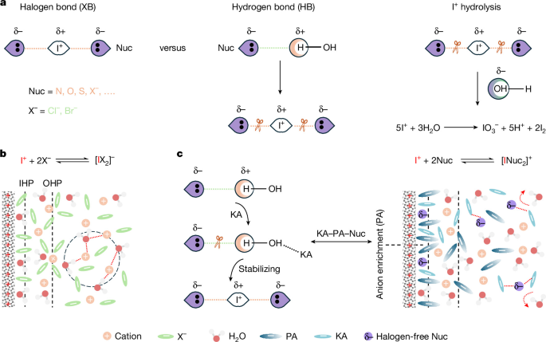
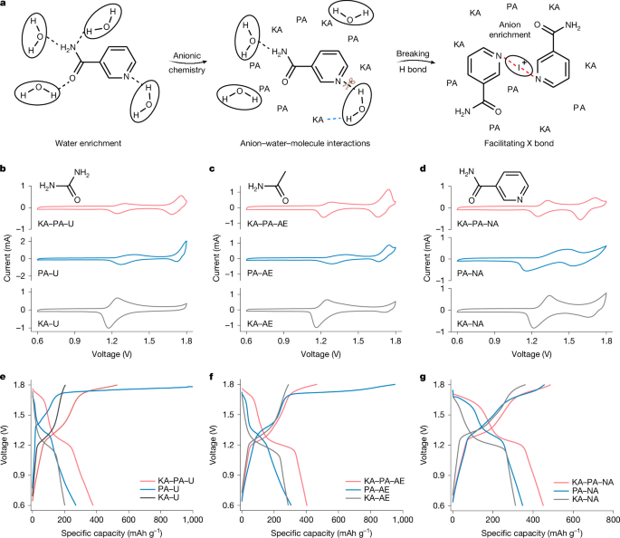
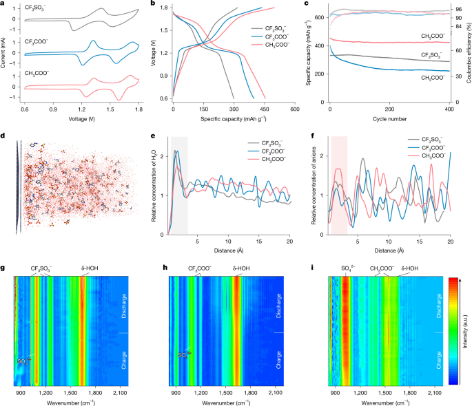
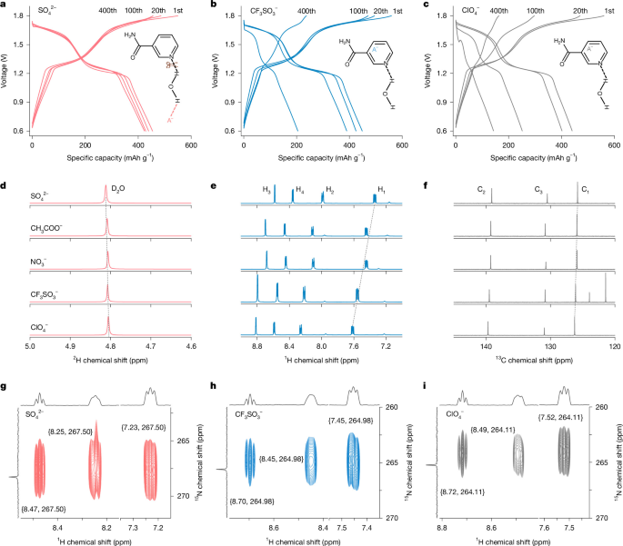

# Non-halogen aqueous electrolytes for four-electron iodine conversion

**中文标题**：用于四电子碘转化的无卤水系电解液

| 项目 | 内容 |
| --- | --- |
| 期刊 | *Nature*（Article） |
| 在线日期 | 2026-11-11 |
| DOI | [10.1038/s41586-026-11282-0](https://doi.org/10.1038/s41586-026-11282-0) |
| 原文链接 | [nature.com](https://www.nature.com/articles/s41586-026-11282-0) |
| 作者 | Chen, Ruwei, Dong, Haobo, Dai, Yuhang, Wang, Jingyu, Chen, Jie, Liu, Jiyang, Feng, Jianrui, Zhong, Yunpeng, Zong, Wei, Zhang, Wei, Yang, Hang, Cui, Zhe, He, Guanjie |
| 图片 | 4 张（见下，图注中英对照） |

---

## 摘要 / Abstract

**EN**

> Accessing reversible four-electron iodine redox chemistry in aqueous metal–iodine batteries offers a promising route towards high-energy aqueous energy storage, but has conventionally relied on highly concentrated, corrosive halogen-containing electrolytes to stabilize reactive hypervalent iodine cations through interhalogen complexation 1, 2, 3, 4, 5, 6, 7, 8, 9. Here we show a kosmotropic anion–polar anion–nucleophilic species (Nuc) electrolyte framework that harnesses anionic chemistry to coordinate the interfacial microenvironment and molecular interactions, enabling reversible four-electron iodine conversion in halogen-free aqueous electrolytes. Polar anions establish a water-deficient, anion-enriched interfacial microenvironment, whereas kosmotropic anions regulate water–Nuc interactions to increase the availability of Nuc for stabilizing hypervalent iodine cations through Nuc–I + –Nuc halogen bonds. This electrolyte framework is validated across diverse Nuc and in both aqueous Zn–I 2 and Al–I 2 batteries. Moving beyond conventional interhalogen stabilization, these findings establish a distinct electrolyte chemistry framework and represent a mechanistic shift for reversible multi-electron iodine chemistry in aqueous environments.

**中文**

> 在水系金属–碘电池中实现可逆的四电子碘氧化还原化学，是通往高比能水系储能的一条有前景的路径，但传统上依赖高浓度、含卤且具腐蚀性的电解液，通过卤间络合来稳定活泼的高价碘阳离子。本文提出一种"亲液阴离子–极性阴离子–亲核物种（KA–PA–Nuc）"电解液框架，借助阴离子化学调控界面微环境与分子间相互作用，从而在无卤水系电解液中实现可逆的四电子碘转化。极性阴离子构建缺水的富阴离子界面微环境，而亲液阴离子调节水–Nuc 相互作用，提高可用于通过 Nuc–I⁺–Nuc 卤键稳定高价碘阳离子的 Nuc 可用性。该电解液框架在多种 Nuc 以及水系 Zn–I₂ 与 Al–I₂ 电池中得到验证。这些发现超越了传统的卤间稳定策略，建立了一种独特的电解液化学框架，标志着水系环境中可逆多电子碘化学的机制转变。

---

## 图片对照 / Figures

### Fig. 1: Comparisons of mechanistic frameworks for four-electron iodine conversion in aqueous electrolytes.

**EN**

> a, The mechanism of the competition between halogen bond and hydrogen bond. b, The conventional interhalogen stabilization mechanism in highly concentrated, halogen-containing electrolytes. c, The KA–PA–Nuc framework levering anionic chemistry and halogen-bond stabilization in halogen-free electrolytes. IHP, inner Helmholtz plane; OHP, outer Helmholtz plane.

**中文**

> a，卤键与氢键相互竞争的机制。b，高浓度含卤电解液中传统的卤间稳定机制。c，KA–PA–Nuc 框架，在无卤电解液中借助阴离子化学与卤键稳定作用。IHP，内亥姆霍兹面；OHP，外亥姆霍兹面。

*原图：s41586-026-11282-0 Fig. 1 · [Nature 全尺寸](https://www.nature.com/articles/s41586-026-11282-0/figures/1)*

### Fig. 2: Demonstration of the proposed KA–PA–Nuc electrolyte framework.

**EN**

> a, Molecular interplay governed by anionic chemistry and halogen bonding. b, Cyclic voltammetry profiles of iodine conversion reaction using urea as Nuc at 0.6 mV s −1. c, Cyclic voltammetry profiles using acetamide as Nuc at 0.6 mV s −1. d, Cyclic voltammetry profiles using nicotinamide as Nuc at 0.6 mV s −1. e – g, Corresponding GCD profiles for b – d at 1 A g −1, respectively. All electrochemical measurements were performed in Zn–I 2 coin cells with an iodine mass loading of 2.2 mg cm −2. Source data

**中文**

> a，由阴离子化学与卤键共同主导的分子相互作用。b，以尿素为 Nuc 时碘转化反应的循环伏安曲线（0.6 mV s⁻¹）。c，以乙酰胺为 Nuc 时的循环伏安曲线（0.6 mV s⁻¹）。d，以烟酰胺为 Nuc 时的循环伏安曲线（0.6 mV s⁻¹）。e–g，分别为 b–d 在 1 A g⁻¹ 下对应的 GCD 曲线。所有电化学测试均在 Zn–I₂ 扣式电池中进行，碘载量 2.2 mg cm⁻²。源数据。

*原图：s41586-026-11282-0 Fig. 2 · [Nature 全尺寸](https://www.nature.com/articles/s41586-026-11282-0/figures/2)*

### Fig. 3: Critical role of polar anions.

**EN**

> a, Cyclic voltammetry profiles in electrolytes with different anions. b, GCD profiles in electrolytes with different anions. The rising and falling voltage curves correspond to charging and discharging processes, respectively. c, Cycling stability in electrolytes with different anions, with upper and lower curves representing Coulombic efficiency and specific capacity, respectively. Electrochemical measurements were performed in Zn–I 2 coin cells with an iodine mass loading of 2.2 mg cm −2. d, Schematic snapshot of the interfacial structure in the electrolyte with CH 3 COO −. e, Corresponding interfacial cumulated density profiles of H 2 O in electrolytes with different anions, with the grey shaded region highlighting interfacial variations. f, Corresponding interfacial cumulated density profiles of anions in electrolytes with different anions, with the pink shaded region highlighting interfacial variations. g – i, In situ ATR-IR spectra in the electrolytes with CF 3 SO 3 − ( g ), CF 3 COO − ( h ) and CH 3 COO − ( i ). Source data

**中文**

> a，不同阴离子电解液中的循环伏安曲线。b，不同阴离子电解液中的 GCD 曲线；上升与下降电压曲线分别对应充电与放电过程。c，不同阴离子电解液中的循环稳定性，上下两条曲线分别代表库仑效率与比容量。电化学测试在碘载量 2.2 mg cm⁻² 的 Zn–I₂ 扣式电池中进行。d，含 CH₃COO⁻ 电解液中界面结构的示意快照。e，不同阴离子电解液中 H₂O 的界面累积密度分布，灰色阴影标出界面差异。f，不同阴离子电解液中阴离子的界面累积密度分布，粉色阴影标出界面差异。g–i，含 CF₃SO₃⁻（g）、CF₃COO⁻（h）与 CH₃COO⁻（i）电解液的原位 ATR-IR 光谱。源数据。

*原图：s41586-026-11282-0 Fig. 3 · [Nature 全尺寸](https://www.nature.com/articles/s41586-026-11282-0/figures/3)*

### Fig. 4: Critical role of kosmotropic anions.

**EN**

> a, GCD profiles in the electrolyte containing SO 4 2− at different cycles. b, GCD profiles in the electrolyte containing CF 3 SO 3 − at different cycles. c, GCD profiles in the electrolyte containing ClO 4 − at different cycles. Electrochemical measurements were performed in Zn–I 2 coin cells with an iodine mass loading of 2.2 mg cm −2. d, 2 H NMR spectra of electrolytes containing different anions. e, 1 H NMR spectra of electrolytes containing different anions. f, 13 C NMR spectra of electrolytes containing different anions. g, Two-dimensional 1 H– 15 N HMBC NMR spectrum of the electrolyte containing SO 4 2−. h, Two-dimensional 1 H– 15 N HMBC NMR spectrum of the electrolyte containing CF 3 SO 3 −. i, Two-dimensional 1 H– 15 N HMBC NMR spectrum of the electrolyte containing ClO 4 −. Source data

**中文**

> a，含 SO₄²⁻ 电解液在不同循环圈数下的 GCD 曲线。b，含 CF₃SO₃⁻ 电解液在不同循环圈数下的 GCD 曲线。c，含 ClO₄⁻ 电解液在不同循环圈数下的 GCD 曲线。电化学测试在碘载量 2.2 mg cm⁻² 的 Zn–I₂ 扣式电池中进行。d，含不同阴离子电解液的 ²H NMR 谱。e，含不同阴离子电解液的 ¹H NMR 谱。f，含不同阴离子电解液的 ¹³C NMR 谱。g，含 SO₄²⁻ 电解液的二维 ¹H–¹⁵N HMBC NMR 谱。h，含 CF₃SO₃⁻ 电解液的二维 ¹H–¹⁵N HMBC 谱。i，含 ClO₄⁻ 电解液的二维 ¹H–¹⁵N HMBC 谱。源数据。

*原图：s41586-026-11282-0 Fig. 4 · [Nature 全尺寸](https://www.nature.com/articles/s41586-026-11282-0/figures/4)*

---

抓取时间：2026-11-15T14:13:24.084Z · 文本与图注版权归 Springer Nature 所有，此处仅作个人阅读与研究存档。
