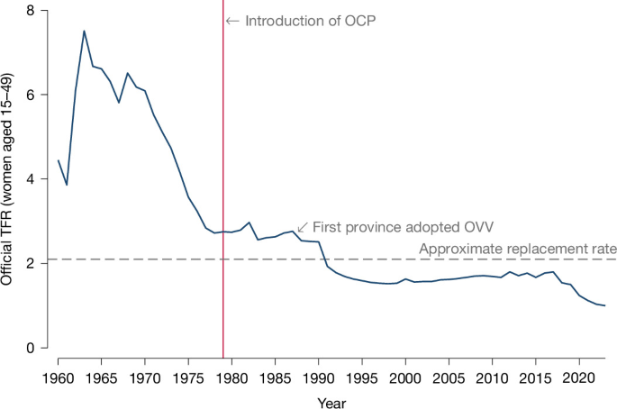
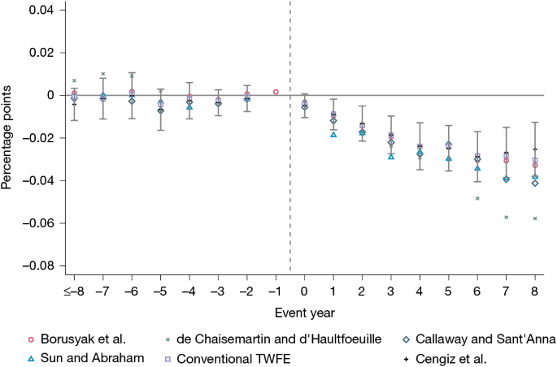
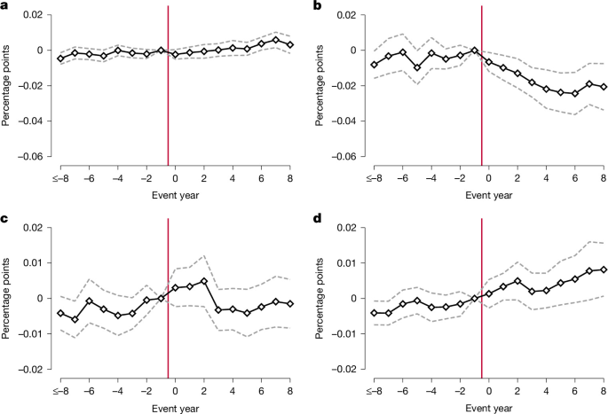
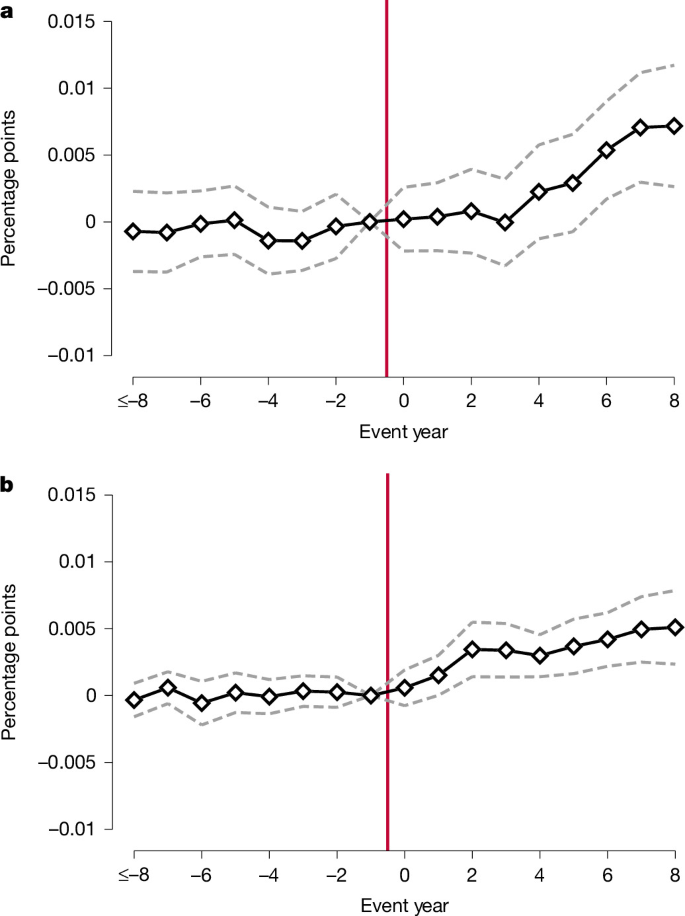
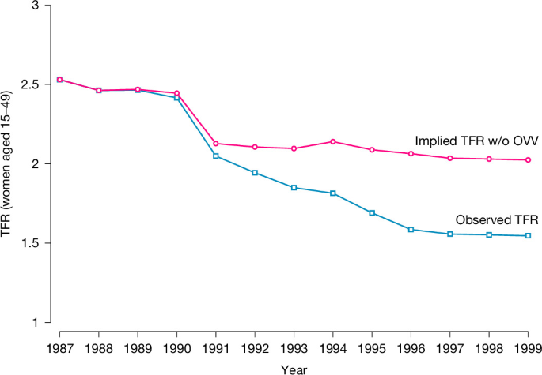

# Bureaucratic incentives shaped effectiveness of the one-child policy in China

**中文标题**：官僚激励塑造了中国独生子女政策的有效性

| 项目 | 内容 |
| --- | --- |
| 期刊 | *Nature*（Article） |
| 在线日期 | 2026-11-11 |
| DOI | [10.1038/s41586-026-11232-w](https://doi.org/10.1038/s41586-026-11232-w) |
| 原文链接 | [nature.com](https://www.nature.com/articles/s41586-026-11232-w) |
| 作者 | Meng, Lingsheng, Yang, Hanmo, Miller, Grant, Li, Hongbin |
| 图片 | 5 张（见下，图注中英对照） |

---

## 摘要 / Abstract

**EN**

> Empirical research so far largely suggests that population policies around the world do not explain a majority of the global fertility decline 1, 2, 3, 4, 5, 6, 7, 8, 9, 10. Notably, even China’s total fertility rate declined little after implementation of the one-child policy in 1979 and 1980, but fertility then fell sharply by more than one-third during the early 1990s. Here we show that strengthening bureaucratic incentives under China’s one vote veto policy, which strictly prohibited career advancement for adherence failure, was instrumental in more effective implementation of the one-child policy, and in its delayed impact on fertility. Using provincial variation in implementation timing, we find that the one vote veto explains nearly half of China’s total fertility rate decline during the 1990s, driving fertility below the replacement rate. Increases in use of intrauterine devices (the most prevalent form of modern contraception in China) that were recommended by local officials were particularly salient. Overall, our findings suggest that population policy, when more strictly enforced due to stronger bureaucratic incentives, made a greater contribution to low fertility in China than suggested by past research.

**中文**

> 迄今为止的实证研究大体表明，世界范围内的人口政策并不能解释全球生育率下降的大部分。值得注意的是，即使中国在 1979 和 1980 年实施独生子女政策后，总和生育率（TFR）也仅小幅下降，但随后在 1990 年代初期大幅下降超过三分之一。本文表明，中国"一票否决"（OVV）政策下强化的官僚激励——该政策严格禁止未达标者的职务晋升——对独生子女政策更有效的执行及其对生育的滞后影响起了关键作用。利用各省实施时点的差异，我们发现 OVV 可解释 1990 年代中国 TFR 下降的近一半，并使生育率降至更替水平以下。由地方官员建议使用的宫内节育器（IUD，中国最主要的现代避孕方式）使用量上升尤为突出。总体而言，我们的发现表明，当人口政策因更强的官僚激励而被更严格执行时，其对中国低生育率的贡献比以往研究所示更大。

---

## 图片对照 / Figures

### Fig. 1: China’s TFR, 1960–2023.

**EN**

> China’s TFR, sourced from the World Population Prospects 2024 by the UN Population Division 62. The replacement rate is the fertility rate needed for a population to exactly reproduce itself from one generation to the next (without migration). Generally, this rate is roughly 2.1 children per woman in many higher-income countries, although it varies with a population’s mortality rates 63, 64.

**中文**

> 中国 TFR，数据来自联合国人口司《世界人口展望 2024》。更替水平是指人口在没有迁移的情况下恰好实现世代自我更替所需的生育率；在许多高收入国家该水平约为每名妇女 2.1 个孩子，但会随人群死亡率而变化。

*原图：s41586-026-11232-w Fig. 1 · [Nature 全尺寸](https://www.nature.com/articles/s41586-026-11232-w/figures/1)*

### Fig. 2: Annual probability of birth event-study estimates relative to the introduction of the OVV policy in China.

**EN**

> Difference-in-differences estimates from equation ( 1 ) for annual probability of birth (pre-policy mean = 0.106) using six different estimators: a dynamic version of the two-way fixed effects (TWFE) model, estimated using ordinary least squares; Cengiz et al. 26; Sun and Abraham 65; Callaway and Sant’Anna 66; de Chaisemartin and d’Haultfoeuille 67; and Borusyak et al. 68. For the ordinary least squares, Sun and Abraham 65 and Cengiz et al. 26 estimators, the coefficient at event time t ≤ −8 represents the accumulated effect for all periods t ≤ −8. For the other estimators, it represents the specific effect at exactly t = −8. The 95% confidence intervals are shown only for the Cengiz et al. 26 estimator, our main specification, and are two-sided and pointwise (not adjusted for multiple comparisons). Inference for the Callaway and Sant’Anna 66 estimator is based on the wild cluster bootstrap. Standard errors for the Cengiz et al. 26 estimator are clustered at the treatment cohort × province level. Standard errors for the remaining estimators are clustered at the province level. The outcome variable is the occurrence of a live birth. The sample includes women aged 15–49 in 2001, and their births between years 1980 and 2001 ( n = 1,906,333 stacked woman-year observations; 36,375 unique women). The vertical dashed line represents when the OVV was implemented. Data are from the 2001 National Family Planning and Reproductive Health Survey.

**中文**

> 基于方程（1）的年度生育概率（政策前均值 = 0.106）的双重差分（DiD）估计，使用六种估计量：以普通最小二乘估计的动态双向固定效应（TWFE）模型；Cengiz 等；Sun 与 Abraham；Callaway 与 Sant'Anna；de Chaisemartin 与 d'Haultfoeuille；以及 Borusyak 等。对 OLS、Sun–Abraham 与 Cengiz 等估计量，事件时间 t ≤ −8 的系数表示所有 t ≤ −8 时期的累积效应；对其他估计量则表示 t = −8 处的具体效应。仅对作为主要设定的 Cengiz 等估计量给出 95% 置信区间，为双侧逐点区间（未做多重比较校正）。Callaway 与 Sant'Anna 估计量的推断基于 wild cluster bootstrap。Cengiz 等估计量的标准误在处理队列 × 省份层面聚类，其余估计量在省份层面聚类。结果变量为活产的发生。样本包括 2001 年 15–49 岁女性及其 1980–2001 年间的生育（n = 1,906,333 个堆叠的女性–年观测；36,375 名独立女性）。竖虚线表示 OVV 实施时点。数据来自 2001 年全国计划生育/生殖健康调查。

*原图：s41586-026-11232-w Fig. 2 · [Nature 全尺寸](https://www.nature.com/articles/s41586-026-11232-w/figures/2)*

### Fig. 3: Event study estimates relative to the introduction of the OVV policy in China for induced abortions, pregnancies, female sterilizations and IUD use.

**EN**

> a, Induced abortion. b, Pregnancy. c, Female sterilization. d, IUD use. DiD estimates from equation ( 1 ) for four outcomes using Cengiz and colleagues’ approach 26. Standard errors are clustered at the treatment cohort × province level. The sample used includes women aged 15–49 in 2001, and their induced abortion, pregnancy, sterilization and IUD use between 1980 and 2001 ( n = 1,906,333 stacked woman-year observations; 36,375 unique women). Data are presented as estimated DiD event-study coefficients (point estimates) with 95% confidence intervals. Solid lines with markers show the coefficient estimates, whereas dashed lines show the corresponding 95% confidence intervals, which are two-sided and pointwise (not adjusted for multiple comparisons). The red vertical lines indicate when the OVV policy was implemented. Data are from the 2001 National Family Planning and Reproductive Health Survey.

**中文**

> a，人工流产。b，妊娠。c，女性绝育。d，IUD 使用。采用 Cengiz 等方法的四项结局基于方程（1）的 DiD 估计。标准误在处理队列 × 省份层面聚类。样本包括 2001 年 15–49 岁女性及其 1980–2001 年间的上述结局（n = 1,906,333 个堆叠女性–年观测；36,375 名独立女性）。数据以 DiD 事件研究系数（点估计）及 95% 置信区间呈现；带标记的实线为系数估计，虚线为相应 95% 置信区间（双侧逐点，未做多重比较校正）。红色竖线表示 OVV 政策实施时点。数据来自 2001 年全国计划生育/生殖健康调查。

*原图：s41586-026-11232-w Fig. 3 · [Nature 全尺寸](https://www.nature.com/articles/s41586-026-11232-w/figures/3)*

### Fig. 4: Event study estimates relative to the introduction of the OVV policy in China for voluntary IUD use or recommended use by officials.

**EN**

> a, b, DiD estimates from equation ( 1 ) for use of IUDs using Cengiz and colleagues’ approach 26, estimated separately for voluntary use by women and their families ( a ), and recommended use by officials ( b ). Standard errors are clustered at the treatment cohort × province level. The sample used includes women aged 15–49 in 2001, and their use of IUD between years 1980 and 2001 ( n = 1,906,333 stacked woman-year observations; 36,375 unique women). Data are presented as estimated DiD event-study coefficients (point estimates) with 95% confidence intervals. Solid lines with markers show the coefficient estimates, whereas dashed lines show the corresponding 95% confidence intervals, which are two-sided and pointwise (not adjusted for multiple comparisons). The red vertical lines indicate when the OVV policy was implemented. Data are from the 2001 National Family Planning and Reproductive Health Survey.

**中文**

> a、b，采用 Cengiz 等方法的 IUD 使用 DiD 估计，分别针对女性及其家庭的自愿使用（a）与官员的建议使用（b）。标准误在处理队列 × 省份层面聚类。样本包括 2001 年 15–49 岁女性及其 1980–2001 年间的 IUD 使用（n = 1,906,333 个堆叠女性–年观测；36,375 名独立女性）。数据以 DiD 事件研究系数（点估计）及 95% 置信区间呈现；带标记的实线为系数估计，虚线为相应 95% 置信区间（双侧逐点，未做多重比较校正）。红色竖线表示 OVV 政策实施时点。数据来自 2001 年全国计划生育/生殖健康调查。

*原图：s41586-026-11232-w Fig. 4 · [Nature 全尺寸](https://www.nature.com/articles/s41586-026-11232-w/figures/4)*

### Fig. 5: Actual and counterfactual sequential multi-decrement TFR estimates for China, with and without the OVV policy, 1987–1999.

**EN**

> The observed TFR (blue line with square markers) and the counterfactual TFR (pink line with circle markers), calculated by subtracting the policy-driven change in TFR implied by estimates in the TFR section from observed TFR in each event year, derived from the event-study sample ( n = 1,906,333 stacked woman-year observations; 36,375 unique women). Data are from the 2001 National Family Planning and Reproductive Health Survey.

**中文**

> 观测 TFR（蓝色方形标记）与反事实 TFR（粉色圆形标记）：后者由各事件年份的观测 TFR 减去 TFR 部分估计所隐含的政策驱动变化得到，均基于事件研究样本（n = 1,906,333 个堆叠女性–年观测；36,375 名独立女性）。数据来自 2001 年全国计划生育/生殖健康调查。

*原图：s41586-026-11232-w Fig. 5 · [Nature 全尺寸](https://www.nature.com/articles/s41586-026-11232-w/figures/5)*

---

抓取时间：2026-11-15T14:13:24.084Z · 文本与图注版权归 Springer Nature 所有，此处仅作个人阅读与研究存档。
