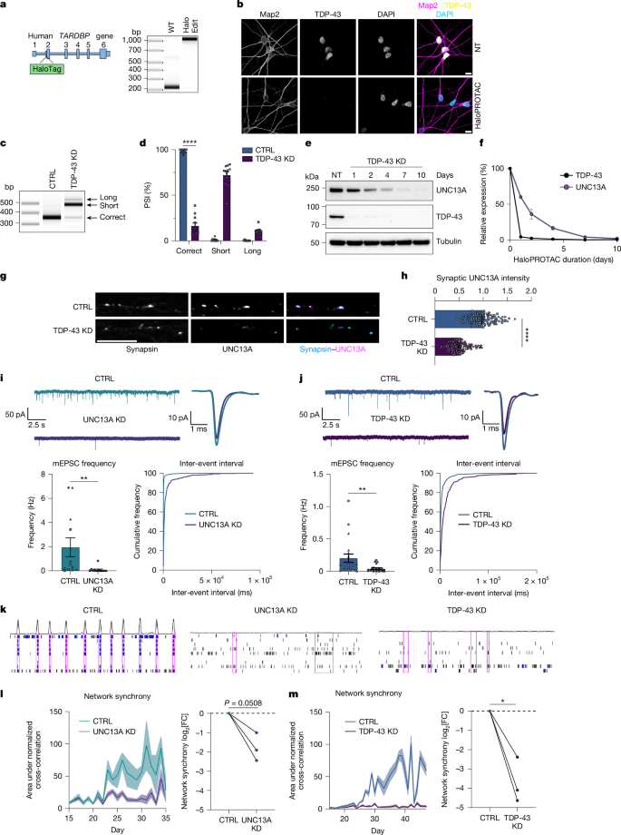
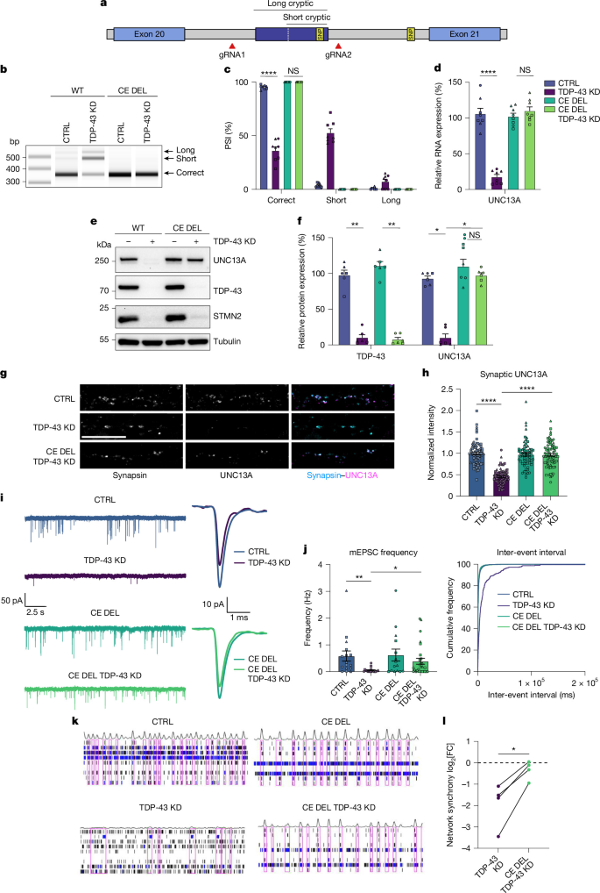
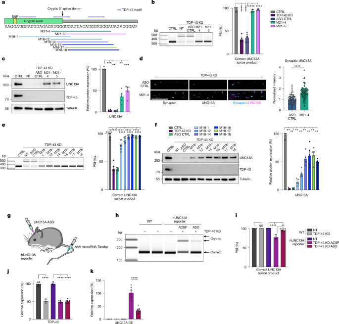
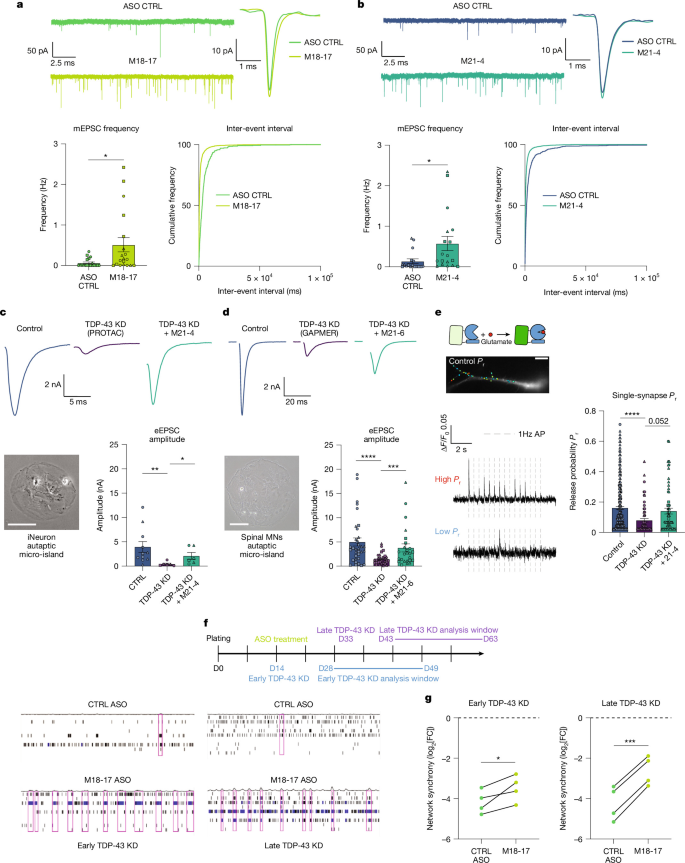

# UNC13A splice correction rescues synaptic dysfunction induced by TDP-43 loss

**中文标题**：UNC13A 剪接校正可挽救 TDP-43 缺失所致的突触功能障碍

| 项目 | 内容 |
| --- | --- |
| 期刊 | *Nature*（Article） |
| 在线日期 | 2026-11-11 |
| DOI | [10.1038/s41586-026-11256-2](https://doi.org/10.1038/s41586-026-11256-2) |
| 原文链接 | [nature.com](https://www.nature.com/articles/s41586-026-11256-2) |
| 作者 | Keuss, Matthew J., Harley, Peter, Ryadnov, Eugeni, Jackson, Rachel E., Boll, Moritz, Zanovello, Matteo, Wilkins, Oscar G., Barattucci, Simone, Ilic, Dragana, Simkin, Rebecca L., Chien, Max Z. Y. J., Cammack, Alexander J., Šoltić, Darija, Mehta, Puja R., Ling, Yan To, Kowald, Maria, Morrie, Ryan D., Miller, Georgiana, Oliveira, Marcio G., Duddy, Graham, Wood, Sophie, Parkes, Joanna E., Sinha, Aparna, Correa-Sánchez, Andrés F., Isaacs, Adrian M., Oliver, Peter L., Hamid, Fursham, Green, Eric M., Fisher, Elizabeth M. C., Davies, Benjamin, Schiavo, Giampietro, Shah, Mala, Lipstein, Noa, Burrone, Juan, Fratta, Pietro |
| 图片 | 4 张（见下，图注中英对照） |

---

## 摘要 / Abstract

**EN**

> TDP-43 nuclear depletion is a defining pathological feature of amyotrophic lateral sclerosis and frontotemporal dementia that induces widespread cryptic splicing defects in hundreds of transcripts 1, 2, 3, 4, 5, 6, 7, 8. Despite this, whether TDP-43 loss affects synaptic function has remained unclear. Here we show that TDP-43 loss induces a predegenerative state in which neurons remain structurally intact but suffer a substantial breakdown in synaptic communication. Genetic correction of a single cryptic splicing event in UNC13A was sufficient to rescue these deficits. We developed splice-switching antisense oligonucleotides that correct UNC13A cryptic splicing in human cortical and spinal motor neurons and in a humanized mouse model. In human neurons this intervention restored spontaneous and evoked synaptic vesicle release, release probability at individual synapses and wider network synchrony. Together, this establishes UNC13A splice correction as a mechanistically defined and genetically validated therapeutic strategy relevant to roughly 97% of patients with amyotrophic lateral sclerosis and roughly 50% of patients with frontotemporal dementia with TDP-43 pathology.

**中文**

> TDP-43 核内耗竭是肌萎缩侧索硬化（ALS）与额颞叶痴呆（FTD）的标志性病理特征，会在数百个转录本中引发广泛的隐蔽剪接缺陷。尽管如此，TDP-43 缺失是否影响突触功能一直不清楚。本文表明，TDP-43 缺失会诱导一种前退行状态：神经元在结构上仍完整，但突触通讯出现显著崩解。仅对 UNC13A 中单个隐蔽剪接事件的遗传学校正就足以挽救这些缺陷。我们开发了剪接转换反义寡核苷酸（ASO），可在人皮层与脊髓运动神经元以及人源化小鼠模型中校正 UNC13A 隐蔽剪接。在人神经元中，该干预恢复了自发与诱发的突触囊泡释放、单个突触的释放概率以及更广泛的网络同步性。总之，本研究确立了 UNC13A 剪接校正是一种机制明确、经遗传学验证的治疗策略，适用于约 97% 的 ALS 患者和约 50% 伴 TDP-43 病理的 FTD 患者。

---

## 图片对照 / Figures

### Fig. 1: Loss of TDP-43 or UNC13A impairs synapse function.

**EN**

> a, Schematic of HaloTag insertion at the start of TARDBP exon 2 and genomic PCR ( n = 1) confirming editing. b, Immunofluorescence showing nuclear TDP-43 localization in untreated (NT) HaloTDP iNeurons and loss following HaloPROTAC treatment ( n = 3). c, RT–PCR analysis of UNC13A splicing following TDP-43 knockdown. d, Quantification of c; n = 12 biological replicates from 3 experiments. e, Western blot of HaloTDP iNeurons treated with 30 nM HaloPROTAC-E for the indicated times. f, Quantification of e; n = 2 biological replicates. g, Synapsin and UNC13A immunofluorescence in 4-week-old HaloTDP iNeurons cultured on rat astrocytes after 2 weeks of TDP-43 depletion. h, UNC13A intensity at synapsin-positive terminals (control n = 116; TDP-43 knockdown n = 115 synapses; 3 experiments). i, mEPSCs from control ( n = 12) and UNC13A -knockdown ( n = 13) iNeurons (3 experiments), with representative and mean traces, frequency and inter-event interval cumulative distributions. j, mEPSCs from control ( n = 20) and TDP-43-knockdown ( n = 22) HaloTDP iNeurons (3 experiments), with representative and mean traces, frequency and inter-event interval cumulative distributions. k, Representative MEA raster plots (60 s) for control (DIV38) and UNC13A -(DIV32) and TDP-43-(DIV38) knockdown; electrode bursts, blue; network bursts, pink. l, m, Network synchrony over time in control versus UNC13A - ( l ) or TDP-43- ( m ) knockdown iNeurons; knockdown values normalized to control ( n = 18 wells, 3 experiments). Symbols indicate independent experiments. In l, m, lines connect parallel differentiations recorded on the same MEA plate. Statistics: two-sided Student’s t -test ( d ); Gaussian linear mixed-effects model (LMM) with two-sided Satterthwaite-corrected t -tests ( h – j ); two-sided ratio paired t -tests ( l, m ). *P < 0.05; ** P < 0.01; *** P < 0.001; **** P < 0.0001. Uncropped gels are shown in Supplementary Fig. 1. Scale bars, 10 µm. In all figures, error bars represent mean ± s.e.m. CTRL, control; DIV, days in vitro; FC, fold change; KD, knockdown; NS, not significant; NT, no treatment; PSI, percentage spliced in. Source data

**中文**

> a，在 TARDBP 第 2 外显子起始处插入 HaloTag 的示意图及确认编辑的基因组 PCR（n = 1）。b，免疫荧光显示未处理（NT）HaloTDP iNeuron 中 TDP-43 的核定位，以及 HaloPROTAC 处理后的丢失（n = 3）。c，TDP-43 敲低后 UNC13A 剪接的 RT–PCR 分析。d，c 的定量；n = 12 个生物学重复（3 次实验）。e，以 30 nM HaloPROTAC-E 处理指定时间的 HaloTDP iNeuron 的免疫印迹。f，e 的定量；n = 2 个生物学重复。g，TDP-43 缺失 2 周后，培养于大鼠星形胶质细胞上的 4 周龄 HaloTDP iNeuron 中 Synapsin 与 UNC13A 的免疫荧光。h，synapsin 阳性终末处的 UNC13A 强度（对照 n = 116；TDP-43 敲低 n = 115 个突触；3 次实验）。i，对照（n = 12）与 UNC13A 敲低（n = 13）iNeuron 的 mEPSC（3 次实验），含代表性及平均波形、频率与事件间期累积分布。j，对照（n = 20）与 TDP-43 敲低（n = 22）HaloTDP iNeuron 的 mEPSC（3 次实验），内容同上。k，对照（DIV38）、UNC13A 敲低（DIV32）与 TDP-43 敲低（DIV38）的代表性 MEA 栅格图（60 s）；电极爆发为蓝色，网络爆发为粉色。l、m，对照与 UNC13A（l）或 TDP-43（m）敲低 iNeuron 的网络同步性随时间变化；敲低组数值以对照归一化（n = 18 孔，3 次实验）。符号表示独立实验；l、m 中连线连接同一 MEA 板上平行分化的样本。统计：双侧 Student t 检验（d）；高斯线性混合效应模型（LMM）配合双侧 Satterthwaite 校正 t 检验（h–j）；双侧比值配对 t 检验（l、m）。*P < 0.05；**P < 0.01；***P < 0.001；****P < 0.0001。未裁剪凝胶见补充图 1。标尺 10 µm。各图误差棒为平均值 ± 标准误。CTRL，对照；DIV，体外天数；FC，倍数变化；KD，敲低；NS，无显著差异；NT，未处理；PSI，包含率。源数据。

*原图：s41586-026-11256-2 Fig. 1 · [Nature 全尺寸](https://www.nature.com/articles/s41586-026-11256-2/figures/1)*

### Fig. 2: Genomic deletion of UNC13A cryptic exon rescues synapse function following TDP-43 loss.

**EN**

> a, Schematic of genomic deletion of the UNC13A cryptic exon (CE). b – f, Analysis of WT and CE deletion (CE DEL) HaloTDP iNeurons on DIV28 following 14 days of HaloPROTAC treatment. b, RT–PCR showing that CE DEL restores UNC13A exon 20–21 splicing after TDP-43 knockdown. c, Quantification of b; n = 6 biological replicates from 3 experiments. d, RT–qPCR of correctly spliced UNC13A showing rescued RNA levels after TDP-43 knockdown; n = 6 biological replicates from 3 experiments. e, Western blot showing rescue of UNC13A protein levels by CE DEL. f, Quantification of e; n = 6 biological replicates from 3 experiments. g, Synapsin and UNC13A immunofluorescence in 4-week-old HaloTDP and CE DEL iNeurons cultured on rat astrocytes after 2 weeks of TDP-43 knockdown. h, UNC13A intensity at synapsin-positive terminals (control n = 71; TDP-43 knockdown n = 71; cryptic exon Del n = 66; CE DEL + TDP-43 knockdown n = 75 synapses; 3 experiments). i, Representative and mean mEPSC traces. j, mEPSC frequency and inter-event interval cumulative distributions (control n = 17; TDP-43 knockdown n = 22; CE DEL n = 15; CE DEL + TDP-43 knockdown n = 28 iNeurons; 3 experiments). k, Representative DIV39 MEA raster plots (60 s) for control, TDP-43 knockdown, CE DEL and CE DEL + TDP-43 knockdown; electrode bursts, blue; network bursts, pink. l, Network synchrony following TDP-43 knockdown, expressed as log 2 [fold change] in normalized electrode cross-correlation ( n = 4 independent experiments); lines connect parallel differentiations recorded on the same MEA plate. Statistics: one-way analysis of variance (ANOVA) with Tukey’s test ( c, d ); repeated-measures one-way ANOVA on log-transformed, loading control-normalized values with Tukey’s test ( f ); Gaussian LMM with two-sided Satterthwaite-corrected t -tests ( h, j ); two-sided paired ratio t -test ( l ). *P < 0.05; ** P < 0.01; *** P < 0.001; **** P < 0.0001. Scale bar, 10 µm. gRNA, guide RNA. Uncropped gels are shown in Supplementary Fig. 2. Source data

**中文**

> a，基因组删除 UNC13A 隐蔽外显子（CE）的示意图。b–f，HaloPROTAC 处理 14 天后 DIV28 的野生型（WT）与 CE 缺失（CE DEL）HaloTDP iNeuron 分析。b，RT–PCR 显示 TDP-43 敲低后 CE DEL 恢复了 UNC13A 第 20–21 外显子剪接。c，b 的定量；n = 6 个生物学重复（3 次实验）。d，正确剪接 UNC13A 的 RT–qPCR，显示 TDP-43 敲低后 RNA 水平被挽救；n = 6 个生物学重复（3 次实验）。e，免疫印迹显示 CE DEL 挽救了 UNC13A 蛋白水平。f，e 的定量；n = 6 个生物学重复（3 次实验）。g，TDP-43 敲低 2 周后，4 周龄 HaloTDP 与 CE DEL iNeuron 中 Synapsin 与 UNC13A 的免疫荧光。h，synapsin 阳性终末处 UNC13A 强度（对照 n = 71；TDP-43 敲低 n = 71；CE 缺失 n = 66；CE DEL + TDP-43 敲低 n = 75 个突触；3 次实验）。i，代表性及平均 mEPSC 波形。j，mEPSC 频率与事件间期累积分布（对照 n = 17；TDP-43 敲低 n = 22；CE DEL n = 15；CE DEL + TDP-43 敲低 n = 28 个 iNeuron；3 次实验）。k，对照、TDP-43 敲低、CE DEL 及 CE DEL + TDP-43 敲低的代表性 DIV39 MEA 栅格图（60 s）；电极爆发蓝色，网络爆发粉色。l，TDP-43 敲低后的网络同步性，以归一化电极互相关的 log2[倍数变化] 表示（n = 4 次独立实验）；连线连接同一 MEA 板上平行分化的样本。统计：单因素方差分析（ANOVA）配合 Tukey 检验（c、d）；对 log 转换并按上样对照归一化的数值作重复测量单因素 ANOVA 配合 Tukey 检验（f）；高斯 LMM 配合双侧 Satterthwaite 校正 t 检验（h、j）；双侧配对比值 t 检验（l）。*P < 0.05；**P < 0.01；***P < 0.001；****P < 0.0001。标尺 10 µm。gRNA，向导 RNA。未裁剪凝胶见补充图 2。源数据。

*原图：s41586-026-11256-2 Fig. 2 · [Nature 全尺寸](https://www.nature.com/articles/s41586-026-11256-2/figures/2)*

### Fig. 3: UNC13A splice-switching ASOs rescue UNC13A expression following TDP-43 loss.

**EN**

> a, Schematic of ASOs targeting the UNC13A cryptic donor splice site. b, RT–PCR showing 21-nt ASOs prevent UNC13A cryptic splicing after TDP-43 knockdown, with quantification (percentage spliced in; n = 6 biological replicates from 3 experiments). c, Western blot showing rescue of UNC13A protein following 21-nt ASO treatment after TDP-43 knockdown, with quantification ( n = 5 biological replicates from 3 experiments). d, UNC13A intensity at synapsin-positive terminals in TDP-43-knockdown iNeurons treated with MOE CTRL ASO ( n = 88) or M21-4 ASO ( n = 96). e, RT–PCR showing 18-nt ASOs prevent cryptic splicing after TDP-43 knockdown, with quantification (percentage spliced in; n = 6 biological replicates from 3 experiments). f, Western blot showing rescue of UNC13A protein following 18-nt ASO treatment after TDP-43 knockdown, with quantification ( n = 5 biological replicates from 3 experiments). g, Schematic of the in vivo ASO splice correction experiment. h, RT–PCR of spinal cord from WT and hUNC13A reporter mice showing that M21-4 ASO reduces cryptic splicing after TDP-43 knockdown. i, Quantification of h (percentage spliced in). WT NT n = 4, WT TDP-43 KD n = 3, hUNC13A NT n = 5, hUNC13A ACSF n = 7, hUNC13A ASO n = 9. j, k, RT–qPCR of TDP-43 ( j ) and UNC13A cryptic exon ( k ) in WT and hUNC13A reporter mice. Statistics: one-way ANOVA with Tukey’s test ( b, e, i – k ); repeated-measures one-way ANOVA on log-transformed, loading control-normalized values with Tukey’s test ( c, f ); Gaussian LMM with two-sided Satterthwaite-corrected t -test ( d ). ** P < 0.01; *** P < 0.001; **** P < 0.0001. Scale bar, 10 µm. Uncropped gels are shown in Supplementary Fig. 3. ACSF, artificial cerebrospinal fluid; AAV, adeno-associated virus. Illustrations in g adapted from the NIH BioArt Source ( https://bioart.niaid.nih.gov/bioart/505 ). Source data

**中文**

> a，靶向 UNC13A 隐蔽供体剪接位点的 ASO 示意图。b，RT–PCR 显示 21 nt ASO 可阻止 TDP-43 敲低后的 UNC13A 隐蔽剪接，并附定量（包含率；n = 6 个生物学重复，3 次实验）。c，免疫印迹显示 TDP-43 敲低后 21 nt ASO 处理挽救了 UNC13A 蛋白，并附定量（n = 5 个生物学重复，3 次实验）。d，TDP-43 敲低 iNeuron 经 MOE 对照 ASO（n = 88）或 M21-4 ASO（n = 96）处理后，synapsin 阳性终末处的 UNC13A 强度。e，RT–PCR 显示 18 nt ASO 可阻止 TDP-43 敲低后的隐蔽剪接，并附定量（包含率；n = 6 个生物学重复，3 次实验）。f，免疫印迹显示 TDP-43 敲低后 18 nt ASO 处理挽救了 UNC13A 蛋白，并附定量（n = 5 个生物学重复，3 次实验）。g，体内 ASO 剪接校正实验示意图。h，WT 与 hUNC13A 报告小鼠脊髓 RT–PCR，显示 M21-4 ASO 在 TDP-43 敲低后减少隐蔽剪接。i，h 的定量（包含率）：WT NT n = 4，WT TDP-43 KD n = 3，hUNC13A NT n = 5，hUNC13A ACSF n = 7，hUNC13A ASO n = 9。j、k，WT 与 hUNC13A 报告小鼠中 TDP-43（j）与 UNC13A 隐蔽外显子（k）的 RT–qPCR。统计：单因素 ANOVA 配合 Tukey 检验（b、e、i–k）；对 log 转换并按上样对照归一化的数值作重复测量单因素 ANOVA 配合 Tukey 检验（c、f）；高斯 LMM 配合双侧 Satterthwaite 校正 t 检验（d）。**P < 0.01；***P < 0.001；****P < 0.0001。标尺 10 µm。未裁剪凝胶见补充图 3。ACSF，人工脑脊液；AAV，腺相关病毒。g 中插图改编自 NIH BioArt Source（https://bioart.niaid.nih.gov/bioart/505）。源数据。

*原图：s41586-026-11256-2 Fig. 3 · [Nature 全尺寸](https://www.nature.com/articles/s41586-026-11256-2/figures/3)*

### Fig. 4: UNC13A splice-switching ASOs rescue synapse function following TDP-43 loss.

**EN**

> a, Representative and mean mEPSC traces from TDP-43-knockdown iNeurons treated with CTRL ASO ( n = 19) or M18-17 ASO ( n = 19), with quantification of mEPSC frequency and inter-event interval cumulative distributions. b, Representative and mean mEPSC traces from TDP-43-knockdown iNeurons treated with MOE CTRL ASO ( n = 17) or M21-4 ASO ( n = 18), with quantification of mEPSC frequency and inter-event interval cumulative distributions. c, Representative autaptic micro-island image and eEPSC traces from control, HaloPROTAC-mediated TDP-43 knockdown (DIV14) and TDP-43 knockdown + M21-4 ASO iNeurons, with eEPSC amplitude quantification (control n = 11; knockdown n = 6; knockdown + M21-4 n = 6; 3 independent differentiations). d, Representative autaptic micro-island image and eEPSC traces from control and gapmer-mediated TDP-43-knockdown (DIV45) spinal motor neurons (MNs) treated with M21-6, with eEPSC amplitude quantification (control n = 34; knockdown n = 30; knockdown + M21-6 n = 25 neurons; 3 independent differentiations). e, Example iNeuron dendrite expressing iGluSnFR3. Synapses were classified by release probability ( P r ) after 45 field stimuli at 1 Hz. Quantification of single-synapse P r in control ( n = 285), TDP-43-knockdown ( n = 71) and knockdown + M21-4 ASO ( n = 66) synapses from 3 independent experiments. Δ F / F 0, fractional change in fluorescence. f, Schematic of early and late TDP-43 knockdown in MEA recordings with representative raster plots; DIV49 for early, DIV45 for late (60 s); electrode bursts, blue; network bursts, pink. D, day. g, Network synchrony (log 2 [fold change versus control]) in HaloTDP iNeurons treated with CTRL or M18-17 ASO ( n = 4 independent experiments); lines connect parallel differentiations recorded on the same MEA plate. Statistics: Gaussian LMM with two-sided Satterthwaite-corrected t -tests ( a – e ); two-sided paired ratio t -test ( g ). *P < 0.05; ** P < 0.01; *** P < 0.001; **** P < 0.0001. Scale bars, 100 µm. Source data

**中文**

> a，TDP-43 敲低 iNeuron 经对照 ASO（n = 19）或 M18-17 ASO（n = 19）处理的代表性及平均 mEPSC 波形，并附 mEPSC 频率与事件间期累积分布定量。b，TDP-43 敲低 iNeuron 经 MOE 对照 ASO（n = 17）或 M21-4 ASO（n = 18）处理的代表性及平均 mEPSC 波形，内容同上。c，对照、HaloPROTAC 介导 TDP-43 敲低（DIV14）及 TDP-43 敲低 + M21-4 ASO 的 iNeuron 的代表性自突触微岛图像与 eEPSC 波形，并附 eEPSC 幅度定量（对照 n = 11；敲低 n = 6；敲低 + M21-4 n = 6；3 次独立分化）。d，对照及 gapmer 介导 TDP-43 敲低（DIV45）的脊髓运动神经元（MN）经 M21-6 处理的代表性自突触微岛图像与 eEPSC 波形，并附幅度定量（对照 n = 34；敲低 n = 30；敲低 + M21-6 n = 25 个神经元；3 次独立分化）。e，表达 iGluSnFR3 的 iNeuron 树突示例；经 1 Hz 场刺激 45 次后按释放概率（Pr）对突触分类。对照（n = 285）、TDP-43 敲低（n = 71）及敲低 + M21-4 ASO（n = 66）突触的单突触 Pr 定量（3 次独立实验）。ΔF/F0，荧光相对变化。f，MEA 记录中早期与晚期 TDP-43 敲低的示意图及代表性栅格图；早期为 DIV49，晚期为 DIV45（60 s）；电极爆发蓝色，网络爆发粉色。D，天。g，经对照或 M18-17 ASO 处理的 HaloTDP iNeuron 的网络同步性（相对对照的 log2[倍数变化]；n = 4 次独立实验）；连线连接同一 MEA 板上平行分化的样本。统计：高斯 LMM 配合双侧 Satterthwaite 校正 t 检验（a–e）；双侧配对比值 t 检验（g）。*P < 0.05；**P < 0.01；***P < 0.001；****P < 0.0001。标尺 100 µm。源数据。

*原图：s41586-026-11256-2 Fig. 4 · [Nature 全尺寸](https://www.nature.com/articles/s41586-026-11256-2/figures/4)*

---

抓取时间：2026-11-15T14:13:24.084Z · 文本与图注版权归 Springer Nature 所有，此处仅作个人阅读与研究存档。
